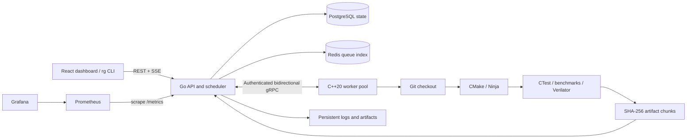

# Architecture and execution guarantees



## Control plane

A submission becomes one build with one job per configuration. The scheduler
orders queued jobs by build submission time, filters workers by heartbeat,
compiler, optional Verilator capability, and available slots, then selects the
worker with the lowest active-job count. Worker IDs break ties deterministically.
Dispatch follows persistence. Each assignment gets an unpredictable lease token.
Every log, artifact chunk, and result must match the job's current worker and
lease. A stale attempt cannot finish a reassigned or cancelled job.

The control plane deliberately runs as **one replica**. PostgreSQL stores a
transactional JSONB snapshot; a mutex serializes state changes. Failed saves
roll back the in-memory state. This makes recovery and invariants easy to inspect
at this project's scale, but is not a horizontally scalable database schema.
Native development uses an atomically replaced, fsynced JSON file instead.

Redis is a sorted scheduling index rebuilt from the authoritative snapshot.
The scheduler reads its ordered queue, then validates each entry against durable
state before dispatch. Redis loss falls back to the durable queue; PostgreSQL
loss stops state-changing work. This avoids the database/queue dual-write loss
window. A future multi-scheduler design requires row-level claims, an outbox,
and durable event tables before adding control-plane replicas.

## Worker and resource ownership

A persistent gRPC stream transports registration, assignments, cancellation,
heartbeats, output, completion metrics, and 64 KiB artifact chunks. One mutex
serializes writes from execution and heartbeat threads; one thread reads
coordinator messages. A fixed `std::jthread` pool limits concurrent jobs.
Each active job owns a `std::stop_source`. Disconnect or shutdown requests
cancellation of every active job before joining the pool.

`posix_spawnp` launches argument vectors directly, without a shell and without
calling `fork` in a multithreaded process. Each process owns a new process group.
RAII wrappers close file descriptors, destroy spawn attributes/actions, and kill
and reap children during exceptions. Nonblocking stdout and stderr are drained
with `poll`. Timeout and cancellation kill the group, including compiler and
test descendants. The deadline covers clone through packaging/upload; transport
writes are terminated by stream cancellation on disconnect or shutdown.

Linux samples process-group RSS from `/proc`; `wait4` records CPU time and peak
RSS as a fallback. macOS reports `wait4` peak RSS rather than a group-wide sample.
Memory sampling can miss very short-lived peaks. A slot controls job concurrency;
`BUILD_PARALLELISM` independently controls Ninja concurrency.

Every attempt uses a distinct workspace removed at scope exit. Git checks out
the fetched ref in detached mode. For reproducibility submit a full commit SHA;
branch names are mutable and are fetched separately by each configuration.
Submodules, Git LFS, private-repository credentials, and distributed build caches
are intentionally not implemented. `regressgrid_build_cache_hits_total` remains
zero until a real cache is introduced.

## States, failures, and recovery

```
queued -> running -> passed | failed | cancelled
running -> queued (infrastructure failure, disconnect, or stale heartbeat)
```

A heartbeat expires after 20 seconds. Worker loss, clone/fetch transport failure,
or control-plane restart requeues unfinished jobs, up to three total attempts.
Compilation/test failures and execution timeouts are terminal. A manual rerun
creates a new build so previous evidence stays intact. Build status remains
running or queued until all configurations finish, then becomes failed if any
job failed, cancelled if any was cancelled, or passed otherwise.

Logs append across attempts with timestamp and attempt labels. The API streams
them as authenticated Server-Sent Events. Logs are limited to approximately
16 MiB per job. Each individual artifact is limited to 256 MiB, receives a
server-side SHA-256 check, and is renamed from a partial file only after the
checksum matches. Artifact paths are validated, and attempts have separate
directories. Promotion creates immutable version metadata referencing the
passed build; downloads provide `X-Checksum-SHA256`. There is no external package
registry or automatic retention policy. Back up PostgreSQL **and** the data volume.

## Regression and release gates

Configuration pairs are matched by compiler and build type. Comparison records
build/test time, memory, warnings, installed size, latency, and throughput. Higher
values regress except throughput, where lower is worse. A relative change over
`REGRESSION_THRESHOLD` (default 10%) fails the gate. Newly introduced warnings
regress even when the baseline count is zero. Missing configurations or failing
candidate jobs make a comparison incomplete. Zero optional benchmark values
represent unavailable measurements.

This first version compares individual runs, not statistical distributions.
Build/test time and memory can be noisy. Use comparable hardware and repeated
benchmark runs before relying on this threshold as a production performance
gate. Failure signatures remove attempt paths, source line numbers, and memory
addresses to cluster related failures.

Promotion requires a passing matrix, verified artifacts for each configuration,
and a passing comparison when a baseline was supplied. A first build may be
promoted without a baseline. Failed and cancelled builds cannot be promoted.

## Trust boundary and deployment scope

This is an internal platform for **trusted repositories**. A CMake build executes
repository-supplied code. Containers constrain CPU/memory and run as a non-root
user, but the worker is not a per-job security sandbox. The temporary build mount permits execution so CTest can launch compiled binaries. Do not offer public
untrusted submissions with this architecture. A production sandbox should
separate each execution from the worker's identity and network credentials.

API and worker tokens are separate. Native listeners default to loopback and
refuse non-loopback bindings without tokens. Compose publishes only loopback
ports. Its default credentials are local demo values. For remote deployments,
replace credentials and use the supplied TLS settings or a trusted private
network/TLS reverse proxy. `/metrics`, `/healthz`, and `/readyz` are operational
endpoints accessible on the service network. The first version has no SSO,
per-user authorization, audit log, or artifact signing.

## Optional hardware plugin

The example ALU implements add, subtract, AND, and XOR. Verilator generates C++,
CMake compiles the simulation, and CTest exercises input vectors. Failing vectors
are printed to the logs; JUnit reports and VCD traces are retained for failed tests when the deadline permits. The dashboard shows a bounded ALU bus waveform preview. Use a waveform
viewer such as GTKWave to inspect traces. AI triage is deferred so the execution
and release path has no model dependency.

## References

Protocol design follows the [gRPC C++ streaming model](https://grpc.io/docs/languages/cpp/basics/).
Metric output follows [Prometheus text exposition](https://prometheus.io/docs/instrumenting/exposition_formats/).
The hardware example uses [Verilator's CMake integration](https://verilator.org/guide/latest/verilating.html).
